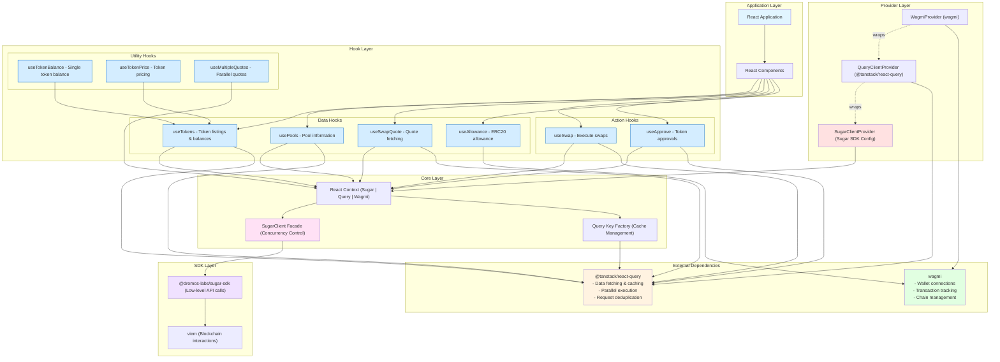
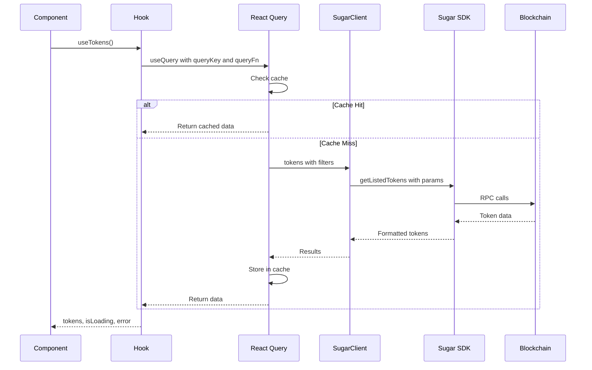
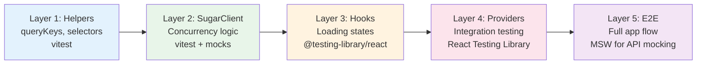
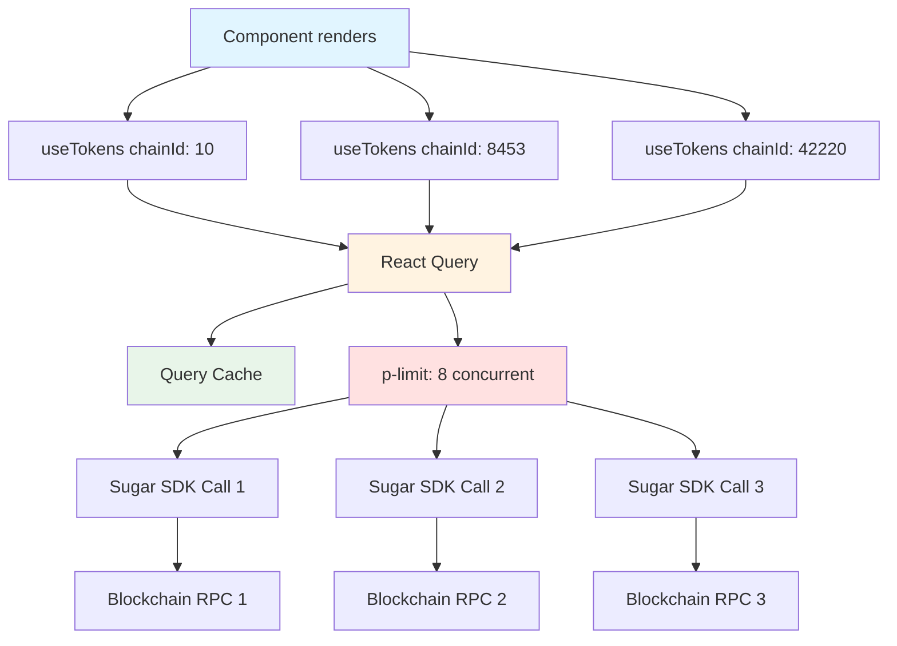
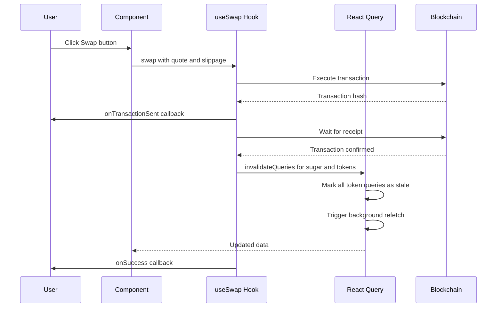

# React Hooks Library - High-Level Architecture

## Main Architecture Diagram

## Key Design Principles

### 1. **Provider Integration**
- Detects existing `WagmiProvider` and `QueryClientProvider` in component tree
- Creates missing providers automatically if not present
- Enables flexible integration with existing React applications

### 2. **Performance Optimization**
- **React Query Features:**
  - Automatic request deduplication (same query keys = single request)
  - Parallel query execution via `useQueries`
  - Configurable caching strategies (`staleTime`, `gcTime`)
  - Background refetching and invalidation
- **Concurrency Control:**
  - `SugarClient` facade with `p-limit` for controlled parallelization
  - Batch quote fetching with `useMultipleQuotes`
  - Prefetching capabilities for navigation optimization

### 3. **Data Flow Pattern**

### 4. **Testing Architecture**

### 5. **Hook Categories**

| Category | Hooks | Purpose | Query Type |
|----------|-------|---------|------------|
| **Data Fetching** | `useTokens`, `usePools` | Read blockchain state | `useQuery` |
| **Quote Management** | `useSwapQuote`, `useMultipleQuotes` | Get swap quotes | `useQuery` with short staleTime |
| **Transactions** | `useSwap`, `useApprove` | Execute blockchain transactions | `useMutation` |
| **State Checking** | `useAllowance`, `useTokenBalance` | Check allowances & balances | `useQuery` or derived from `useTokens` |
| **Utilities** | `usePrefetchTokens` | Performance optimization | Imperative prefetch |

### 6. **Parallel Execution Strategy**

### 7. **Cache Invalidation Flow**

## Implementation Priorities

1. **Phase 1: Foundation**
   - `SugarClientProvider` with provider detection
   - `SugarClient` facade with concurrency control
   - Context setup and helper hooks

2. **Phase 2: Core Hooks**
   - `useTokens` with filtering and caching
   - `useSwapQuote` with debouncing
   - `useAllowance` for approval checks

3. **Phase 3: Transaction Hooks**
   - `useApprove` with transaction tracking
   - `useSwap` with state management
   - Cache invalidation strategy

4. **Phase 4: Performance**
   - `useMultipleQuotes` for parallel quotes
   - Prefetching utilities
   - Optimistic updates

5. **Phase 5: Testing & Polish**
   - Comprehensive test suite
   - Example applications
   - Performance benchmarking
